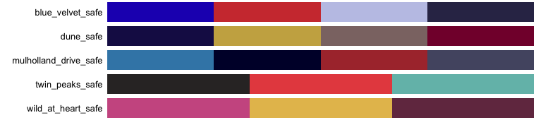
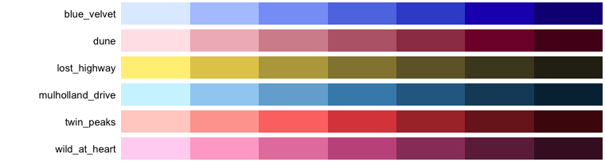
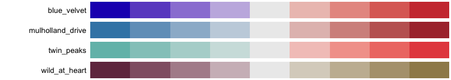

# Lynch

<!-- badges: start -->
<!-- badges: end -->

Color palettes from David Lynch films.

## Installation

Install Lynch from GitHub with:

``` r
# install.packages("pak")
pak::pak("gkaramanis/Lynch")
```

## Example

``` r
library(Lynch)  

lynch_palette("twin_peaks") 
```
  

``` r
lynch_palette("blue_velvet", 3)
```
  

## Available palettes


## Colour-blind-safe palettes

`lynch_accessibility` gives each discrete palette's smallest colour difference, with normal vision and simulated colour blindness. Of the film palettes, only `lost_highway` keeps every colour distinct with red-green colour blindness. The `_safe` palettes keep the colours of each film's palette that do:



``` r
lynch_palette("twin_peaks_safe")
```

## Sequential and diverging ramps

For ordered values, use a sequential ramp; for values either side of a midpoint, a diverging one. Both interpolate to any number of colours:

``` r
lynch_palette("dune", 12, type = "sequential")
lynch_palette("mulholland_drive", type = "diverging")
```





