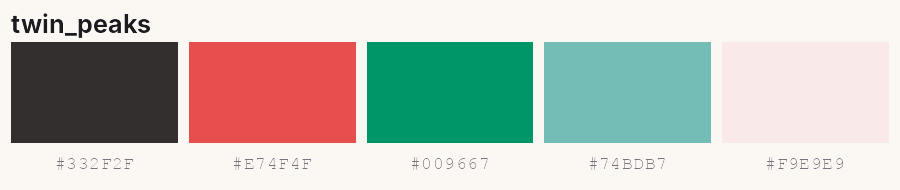
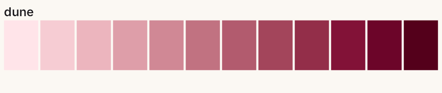
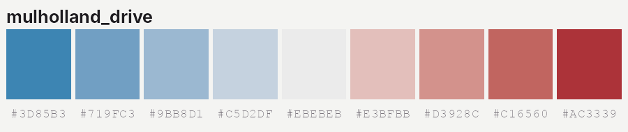
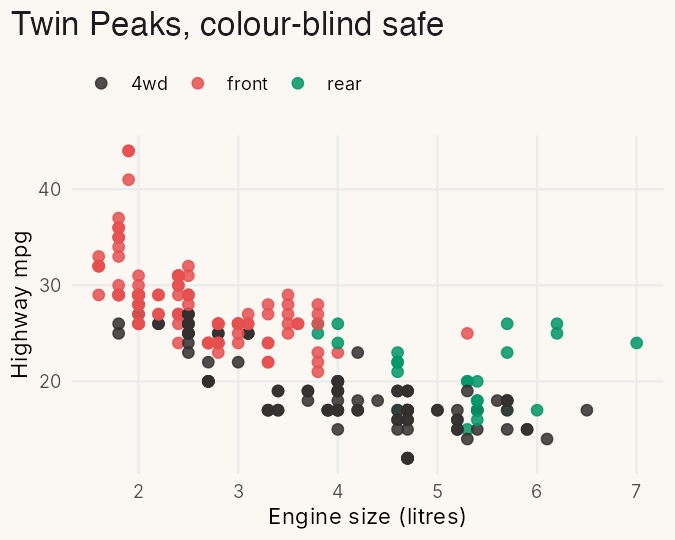
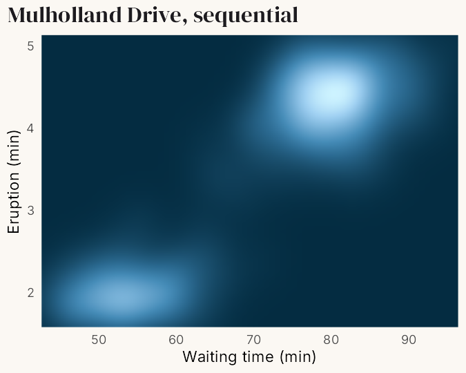
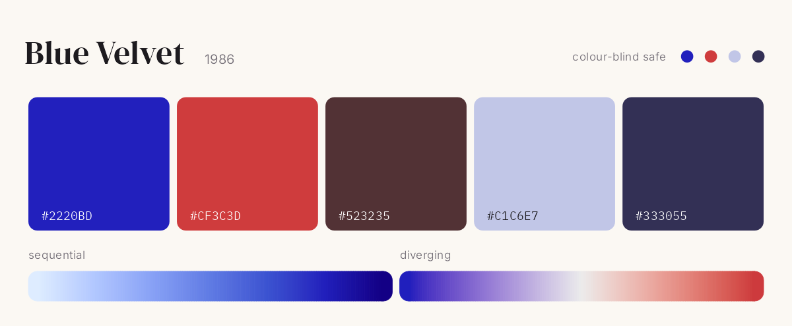
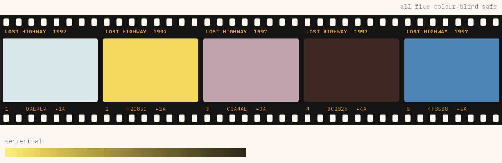
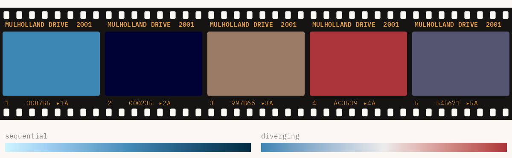
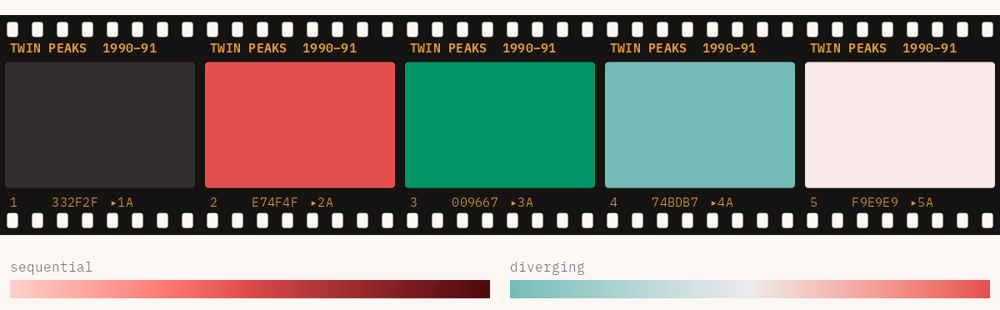
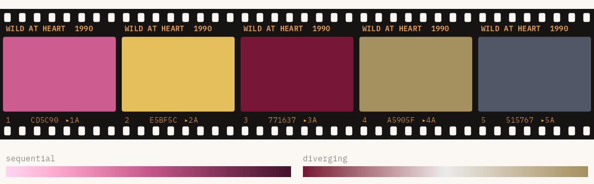

# Lynch

<!-- badges: start -->
[](https://github.com/gkaramanis/Lynch/actions/workflows/R-CMD-check.yaml)
<!-- badges: end -->

Colour palettes from the films of David Lynch, for when a bar chart needs a little dread.

Every film gets five colours. Most also get a colour-blind-safe cut, a sequential ramp for numbers, and sometimes a diverging one. It's a fun package first, but the scales plug straight into ggplot2, and every palette has been through a colour-blindness simulator.

## Installation

``` r
# install.packages("pak")
pak::pak("gkaramanis/Lynch")
```

## Quick start

``` r
library(Lynch)

lynch_palette("twin_peaks")
```



``` r
lynch_palette("blue_velvet", 3)
```


Ramps stretch to as many colours as you like:

``` r
lynch_palette("dune", 12, type = "sequential")
lynch_palette("mulholland_drive", type = "diverging")
```




## With ggplot2

``` r
library(ggplot2)

ggplot(mpg, aes(displ, hwy, colour = drv)) +
  geom_point() +
  scale_colour_lynch_d("twin_peaks")

ggplot(faithfuld, aes(waiting, eruptions, fill = density)) +
  geom_raster() +
  scale_fill_lynch_c("mulholland_drive", direction = -1)
```

<p>


</p>

`_d` scales are for categories and `_c` scales for numbers. For a diverging scale, add `type = "diverging"` and a `midpoint`.

## The palettes

Most palettes were sampled from stills collected in [this Pinterest pin](https://www.pinterest.se/pin/151152131226891232/). Each one sits beside the film's poster from Wikipedia, so you can hold the two up against each other.

### [Blue Velvet](https://en.wikipedia.org/wiki/Blue_Velvet_(film)) (1986)

`"blue_velvet"` · Frames with a dot are colour-blind safe: `"blue_velvet_safe"`.

<table>
<tr>
<td width="18%"><a href="https://en.wikipedia.org/wiki/Blue_Velvet_(film)"></a></td>
<td></td>
</tr>
</table>

<br>

### [Dune](https://en.wikipedia.org/wiki/Dune_(1984_film)) (1984)

`"dune"` · All five colours are colour-blind safe.

<table>
<tr>
<td width="18%"><a href="https://en.wikipedia.org/wiki/Dune_(1984_film)"></a></td>
<td></td>
</tr>
</table>

<br>

### [Lost Highway](https://en.wikipedia.org/wiki/Lost_Highway_(film)) (1997)

`"lost_highway"` · All five colours are colour-blind safe.

<table>
<tr>
<td width="18%"><a href="https://en.wikipedia.org/wiki/Lost_Highway_(film)"></a></td>
<td></td>
</tr>
</table>

<br>

### [Mulholland Drive](https://en.wikipedia.org/wiki/Mulholland_Drive_(film)) (2001)

`"mulholland_drive"` · All five colours are colour-blind safe.

<table>
<tr>
<td width="18%"><a href="https://en.wikipedia.org/wiki/Mulholland_Drive_(film)"></a></td>
<td></td>
</tr>
</table>

<br>

### [Twin Peaks](https://en.wikipedia.org/wiki/Twin_Peaks) (1990–91)

`"twin_peaks"` · All five colours are colour-blind safe. The poster is for *Fire Walk with Me* (1992), the film.

<table>
<tr>
<td width="18%"><a href="https://en.wikipedia.org/wiki/Twin_Peaks"></a></td>
<td></td>
</tr>
</table>

<br>

### [Wild at Heart](https://en.wikipedia.org/wiki/Wild_at_Heart_(film)) (1990)

`"wild_at_heart"` · All five colours are colour-blind safe.

<table>
<tr>
<td width="18%"><a href="https://en.wikipedia.org/wiki/Wild_at_Heart_(film)"></a></td>
<td></td>
</tr>
</table>

<br>

## Colour blindness

Every palette keeps its five colours apart for people with red-green colour blindness, except Blue Velvet. Its `blue_velvet_safe` version keeps the four colours that do, marked with a dot on its film strip. `lynch_accessibility` has the numbers.

``` r
lynch_palette("blue_velvet_safe")
lynch_accessibility
```

## More

The [Get started vignette](vignettes/Lynch.Rmd) walks through every palette type and scale. The figures on this page are built by `data-raw/readme-figures.R`.

*"Black as midnight on a moonless night."*
