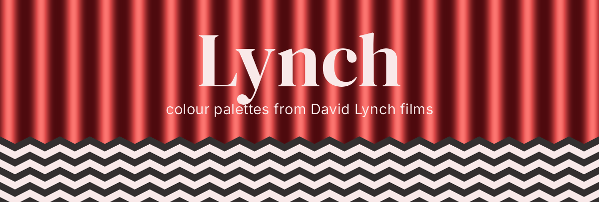

# Lynch

<!-- badges: start -->
[](https://github.com/gkaramanis/Lynch/actions/workflows/R-CMD-check.yaml)
<!-- badges: end -->



Colour palettes from the films of David Lynch, for when a bar chart needs a little dread.

Every film gets five colours. Most also get a colour-blind-safe cut, a sequential ramp for numbers, and sometimes a diverging one. It's a fun package first, but the scales plug straight into ggplot2, and every palette has been through a colour-blindness simulator.

## Installation

``` r
# install.packages("pak")
pak::pak("gkaramanis/Lynch")
```

## Quick start

``` r
library(Lynch)

lynch_palette("twin_peaks")
```


``` r
lynch_palette("blue_velvet", 3)
```


Ramps stretch to as many colours as you like:

``` r
lynch_palette("dune", 12, type = "sequential")
lynch_palette("mulholland_drive", type = "diverging")
```


## With ggplot2

``` r
library(ggplot2)

ggplot(mpg, aes(displ, hwy, colour = drv)) +
  geom_point() +
  scale_colour_lynch_d("twin_peaks_safe")

ggplot(faithfuld, aes(waiting, eruptions, fill = density)) +
  geom_raster() +
  scale_fill_lynch_c("mulholland_drive", direction = -1)
```

<p>


</p>

`_d` scales are for categories and `_c` scales for numbers. For a diverging scale, add `type = "diverging"` and a `midpoint`.

## The palettes

Most palettes were sampled from stills collected in [this Pinterest pin](https://www.pinterest.se/pin/151152131226891232/). Each film's title below links to its Wikipedia article, where you can hold the poster up against the colours.


[**Blue Velvet**](https://en.wikipedia.org/wiki/Blue_Velvet_(film)) · `"blue_velvet"`


[**Dune**](https://en.wikipedia.org/wiki/Dune_(1984_film)) · `"dune"`


[**Lost Highway**](https://en.wikipedia.org/wiki/Lost_Highway_(film)) · `"lost_highway"`


[**Mulholland Drive**](https://en.wikipedia.org/wiki/Mulholland_Drive_(film)) · `"mulholland_drive"`


[**Twin Peaks**](https://en.wikipedia.org/wiki/Twin_Peaks) · `"twin_peaks"`


[**Wild at Heart**](https://en.wikipedia.org/wiki/Wild_at_Heart_(film)) · `"wild_at_heart"`

## Colour blindness

Only Lost Highway keeps all five colours apart for people with red-green colour blindness. The other films have a `_safe` version that keeps the three or four colours that do, shown as dots on each card. `lynch_accessibility` has the numbers.

``` r
lynch_palette("twin_peaks_safe")
lynch_accessibility
```

## More

The [Get started vignette](vignettes/Lynch.Rmd) walks through every palette type and scale. The figures on this page are built by `data-raw/readme-figures.R`.

*"Black as midnight on a moonless night."*
