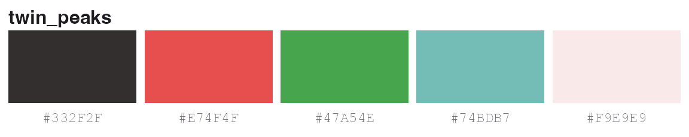
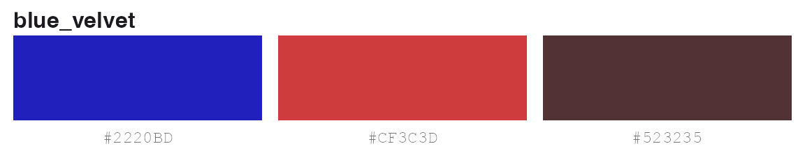
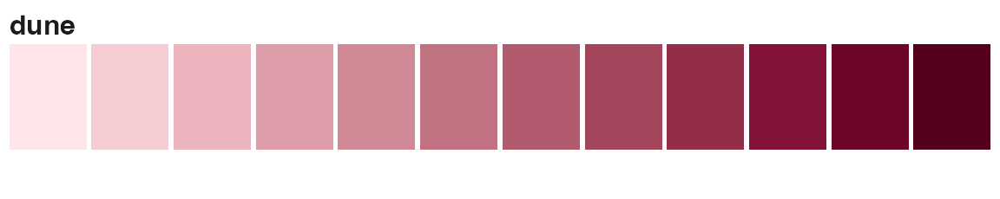
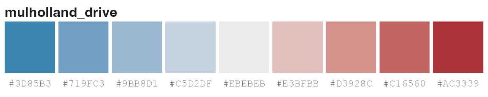
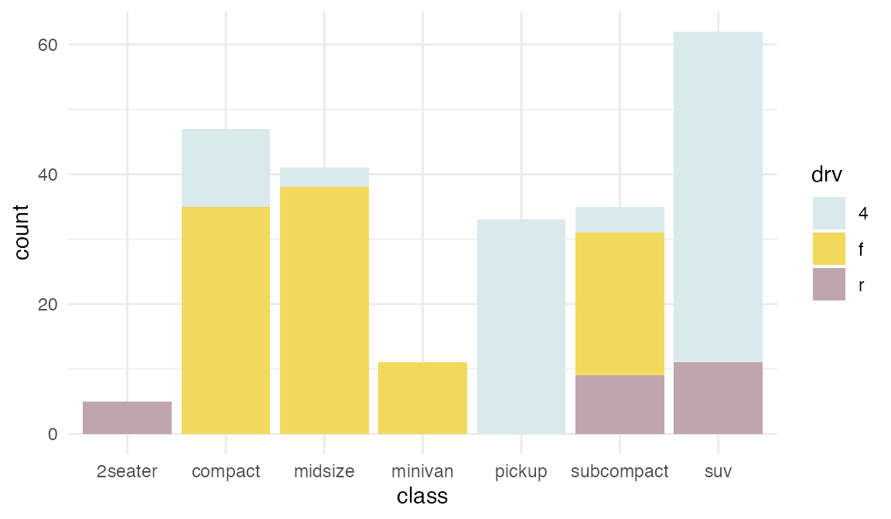
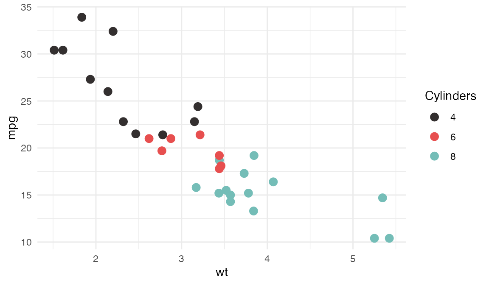
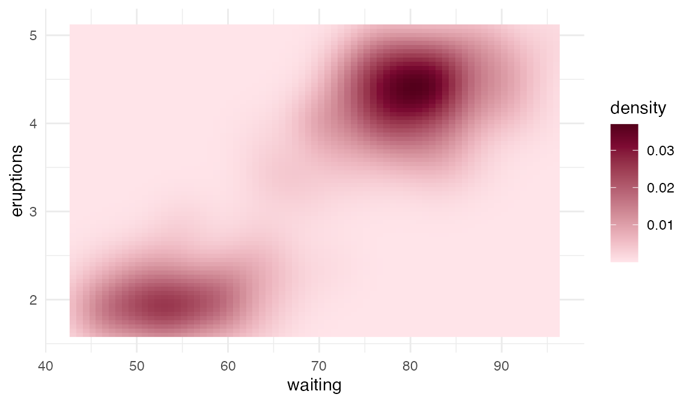
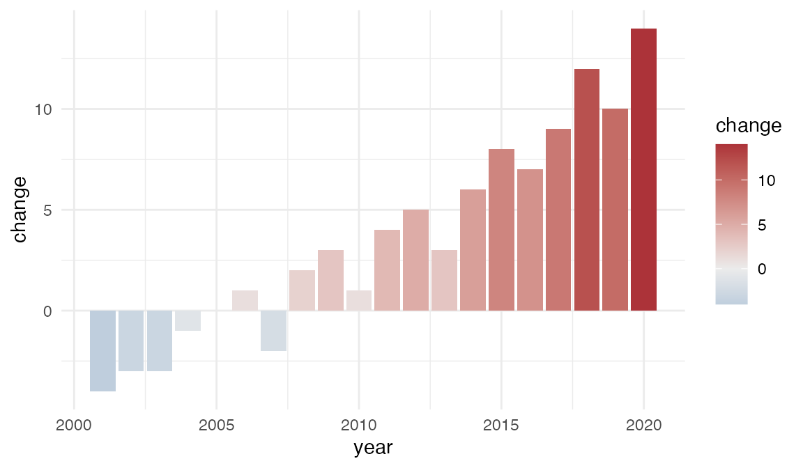
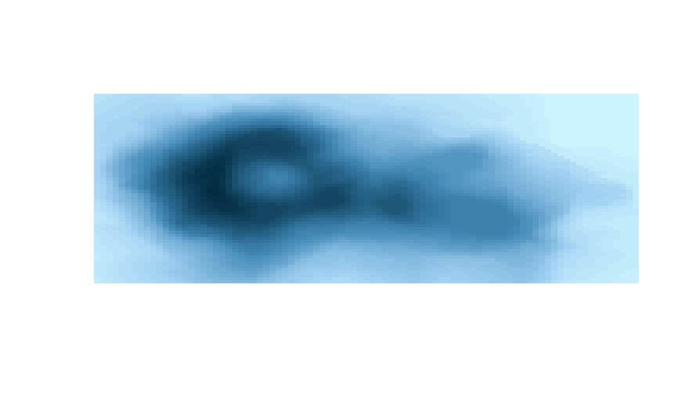

# Get started with Lynch

\
[`library`](https://rdrr.io/r/base/library.html)`(`[`Lynch`](https://github.com/gkaramanis/Lynch)`)`\
[`library`](https://rdrr.io/r/base/library.html)`(`[`ggplot2`](https://ggplot2.tidyverse.org)`)`

Lynch has three kinds of palette. Pick the kind that matches your data:

| Kind       | For                              | Where              |
|------------|----------------------------------|--------------------|
| Discrete   | categories                       | `lynch_palettes`   |
| Sequential | ordered values, low to high      | `lynch_sequential` |
| Diverging  | values either side of a midpoint | `lynch_diverging`  |

## Picking colours

[`lynch_palette()`](https://gkaramanis.github.io/Lynch/reference/lynch_palette.md)
returns a palette by name. Printing it draws the colours.

\
[`lynch_palette`](https://gkaramanis.github.io/Lynch/reference/lynch_palette.md)`(``"twin_peaks"``)`

Ask for fewer colours with `n`. Discrete palettes have five colours, so
`n` can be at most five.

\
[`lynch_palette`](https://gkaramanis.github.io/Lynch/reference/lynch_palette.md)`(``"blue_velvet"``, ``3``)`

Sequential and diverging ramps are interpolated, so they give any number
of colours.

\
[`lynch_palette`](https://gkaramanis.github.io/Lynch/reference/lynch_palette.md)`(``"dune"``, ``12``, type ``=`` ``"sequential"``)`

\
[`lynch_palette`](https://gkaramanis.github.io/Lynch/reference/lynch_palette.md)`(``"mulholland_drive"``, type ``=`` ``"diverging"``)`

The result keeps a `palette` class for printing. Use
[`unclass()`](https://rdrr.io/r/base/class.html) when you want a plain
character vector.

\
[`unclass`](https://rdrr.io/r/base/class.html)`(`[`lynch_palette`](https://gkaramanis.github.io/Lynch/reference/lynch_palette.md)`(``"wild_at_heart"``)``)`\
`#> [1] "#CD5C90" "#E5BF5C" "#73364F" "#9F8A5A" "#515767"`\
`#> attr(,"name")`\
`#> [1] "wild_at_heart"`

## Discrete palettes

There are six film palettes and five colour-blind-safe versions.

\
[`names`](https://rdrr.io/r/base/names.html)`(``lynch_palettes``)`\
`#>  [1] "blue_velvet"           "dune"                  "lost_highway"         `\
`#>  [4] "mulholland_drive"      "twin_peaks"            "wild_at_heart"        `\
`#>  [7] "blue_velvet_safe"      "dune_safe"             "mulholland_drive_safe"`\
`#> [10] "twin_peaks_safe"       "wild_at_heart_safe"`

Use
[`scale_colour_lynch_d()`](https://gkaramanis.github.io/Lynch/reference/scale_colour_lynch_d.md)
or
[`scale_fill_lynch_d()`](https://gkaramanis.github.io/Lynch/reference/scale_colour_lynch_d.md)
for categories.

\
[`ggplot`](https://ggplot2.tidyverse.org/reference/ggplot.html)`(``mpg``, `[`aes`](https://ggplot2.tidyverse.org/reference/aes.html)`(``class``, fill ``=`` ``drv``)``)`` ``+`\
`  `[`geom_bar`](https://ggplot2.tidyverse.org/reference/geom_bar.html)`(``)`` ``+`\
`  `[`scale_fill_lynch_d`](https://gkaramanis.github.io/Lynch/reference/scale_colour_lynch_d.md)`(``"lost_highway"``)`` ``+`\
`  `[`theme_minimal`](https://ggplot2.tidyverse.org/reference/ggtheme.html)`(``)`

Reverse the order with `direction = -1`. If the data has more categories
than the palette has colours, the extra levels are drawn as `NA` and you
get a warning.

## Colour blindness

Of the film palettes, only `lost_highway` keeps every colour distinct
with red-green colour blindness. Each `_safe` palette keeps the three or
four colours of its film’s palette that do. `lynch_accessibility` has
the test results.

\
`lynch_accessibility``[``, `[`c`](https://rdrr.io/r/base/c.html)`(``"palette"``, ``"n_colours"``, ``"deutan"``, ``"protan"``, ``"rating"``)``]`\
`#>                  palette n_colours deutan protan                     rating`\
`#> 1            blue_velvet         5    8.5    6.7 close pair for all viewers`\
`#> 2                   dune         5    8.1    9.2 close pair for all viewers`\
`#> 3           lost_highway         5   15.1   13.2          colour-blind safe`\
`#> 4       mulholland_drive         5   10.1    8.8 close pair for all viewers`\
`#> 5             twin_peaks         5    1.2   14.2      not colour-blind safe`\
`#> 6          wild_at_heart         5    4.2    7.8 close pair for all viewers`\
`#> 7       blue_velvet_safe         4   17.2   18.1          colour-blind safe`\
`#> 8              dune_safe         4   17.5   11.2          colour-blind safe`\
`#> 9  mulholland_drive_safe         4   12.9    8.8          colour-blind safe`\
`#> 10       twin_peaks_safe         3   14.5   23.9          colour-blind safe`\
`#> 11    wild_at_heart_safe         3   21.3   18.5          colour-blind safe`

Use a `_safe` palette when you have four groups or fewer.

\
[`ggplot`](https://ggplot2.tidyverse.org/reference/ggplot.html)`(``mtcars``, `[`aes`](https://ggplot2.tidyverse.org/reference/aes.html)`(``wt``, ``mpg``, colour ``=`` `[`factor`](https://rdrr.io/r/base/factor.html)`(``cyl``)``)``)`` ``+`\
`  `[`geom_point`](https://ggplot2.tidyverse.org/reference/geom_point.html)`(``size ``=`` ``3``)`` ``+`\
`  `[`scale_colour_lynch_d`](https://gkaramanis.github.io/Lynch/reference/scale_colour_lynch_d.md)`(``"twin_peaks_safe"``, name ``=`` ``"Cylinders"``)`` ``+`\
`  `[`theme_minimal`](https://ggplot2.tidyverse.org/reference/ggtheme.html)`(``)`

## Sequential and diverging scales

[`scale_colour_lynch_c()`](https://gkaramanis.github.io/Lynch/reference/scale_colour_lynch_d.md)
and
[`scale_fill_lynch_c()`](https://gkaramanis.github.io/Lynch/reference/scale_colour_lynch_d.md)
map numbers to a ramp. The default is sequential.

\
[`ggplot`](https://ggplot2.tidyverse.org/reference/ggplot.html)`(``faithfuld``, `[`aes`](https://ggplot2.tidyverse.org/reference/aes.html)`(``waiting``, ``eruptions``, fill ``=`` ``density``)``)`` ``+`\
`  `[`geom_raster`](https://ggplot2.tidyverse.org/reference/geom_tile.html)`(``)`` ``+`\
`  `[`scale_fill_lynch_c`](https://gkaramanis.github.io/Lynch/reference/scale_colour_lynch_d.md)`(``"dune"``)`` ``+`\
`  `[`theme_minimal`](https://ggplot2.tidyverse.org/reference/ggtheme.html)`(``)`

For values either side of a reference point, use `type = "diverging"`
and set `midpoint`. Without a midpoint, the grey centre sits halfway
across the data range.

\
`df`` ``<-`` `[`data.frame`](https://rdrr.io/r/base/data.frame.html)`(`\
`  year ``=`` ``2001``:``2020``,`\
`  change ``=`` `[`c`](https://rdrr.io/r/base/c.html)`(``-``4``, ``-``3``, ``-``3``, ``-``1``, ``0``, ``1``, ``-``2``, ``2``, ``3``, ``1``, ``4``, ``5``, ``3``, ``6``, ``8``, ``7``, ``9``, ``12``, ``10``, ``14``)`\
`)`\
\
[`ggplot`](https://ggplot2.tidyverse.org/reference/ggplot.html)`(``df``, `[`aes`](https://ggplot2.tidyverse.org/reference/aes.html)`(``year``, ``change``, fill ``=`` ``change``)``)`` ``+`\
`  `[`geom_col`](https://ggplot2.tidyverse.org/reference/geom_bar.html)`(``)`` ``+`\
`  `[`scale_fill_lynch_c`](https://gkaramanis.github.io/Lynch/reference/scale_colour_lynch_d.md)`(``"mulholland_drive"``, type ``=`` ``"diverging"``, midpoint ``=`` ``0``)`` ``+`\
`  `[`theme_minimal`](https://ggplot2.tidyverse.org/reference/ggtheme.html)`(``)`

Only four films have diverging ramps:

\
[`names`](https://rdrr.io/r/base/names.html)`(``lynch_diverging``)`\
`#> [1] "blue_velvet"      "mulholland_drive" "twin_peaks"       "wild_at_heart"`

## Base graphics

The palettes are plain colour vectors, so they work anywhere R takes
colours.

\
[`image`](https://rdrr.io/r/graphics/image.html)`(``volcano``, col ``=`` `[`lynch_palette`](https://gkaramanis.github.io/Lynch/reference/lynch_palette.md)`(``"mulholland_drive"``, ``50``, type ``=`` ``"sequential"``)``, axes ``=`` ``FALSE``)`

