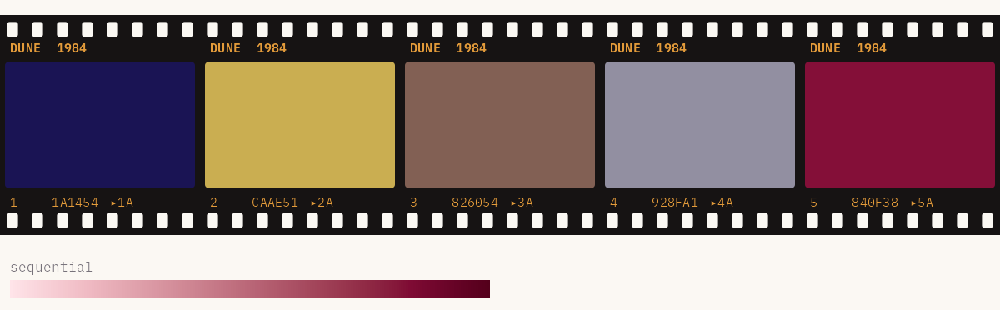

# Lynch

Colour palettes from the films of David Lynch, for when a bar chart
needs a little dread.

Every film gets five colours, a sequential ramp for numbers, and
sometimes a diverging one. Five of the six palettes are colour-blind
safe as they are, and Blue Velvet gets a safe cut. It’s a fun package
first, but the scales plug straight into ggplot2, and every palette has
been through a colour-blindness simulator.

## Installation

\
`# install.packages("pak")`\
`pak``::`[`pak`](https://pak.r-lib.org/reference/pak.html)`(``"gkaramanis/Lynch"``)`

## Quick start

\
[`library`](https://rdrr.io/r/base/library.html)`(`[`Lynch`](https://github.com/gkaramanis/Lynch)`)`\
\
[`lynch_palette`](https://gkaramanis.github.io/Lynch/reference/lynch_palette.md)`(``"twin_peaks"``)`

\
[`lynch_palette`](https://gkaramanis.github.io/Lynch/reference/lynch_palette.md)`(``"blue_velvet"``, ``3``)`

Ramps stretch to as many colours as you like:

\
[`lynch_palette`](https://gkaramanis.github.io/Lynch/reference/lynch_palette.md)`(``"dune"``, ``12``, type ``=`` ``"sequential"``)`\
[`lynch_palette`](https://gkaramanis.github.io/Lynch/reference/lynch_palette.md)`(``"mulholland_drive"``, type ``=`` ``"diverging"``)`

## With ggplot2

\
[`library`](https://rdrr.io/r/base/library.html)`(`[`ggplot2`](https://ggplot2.tidyverse.org)`)`\
\
[`ggplot`](https://ggplot2.tidyverse.org/reference/ggplot.html)`(``mpg``, `[`aes`](https://ggplot2.tidyverse.org/reference/aes.html)`(``displ``, ``hwy``, colour ``=`` ``drv``)``)`` ``+`\
`  `[`geom_point`](https://ggplot2.tidyverse.org/reference/geom_point.html)`(``)`` ``+`\
`  `[`scale_colour_lynch_d`](https://gkaramanis.github.io/Lynch/reference/scale_colour_lynch_d.md)`(``"twin_peaks"``)`\
\
[`ggplot`](https://ggplot2.tidyverse.org/reference/ggplot.html)`(``faithfuld``, `[`aes`](https://ggplot2.tidyverse.org/reference/aes.html)`(``waiting``, ``eruptions``, fill ``=`` ``density``)``)`` ``+`\
`  `[`geom_raster`](https://ggplot2.tidyverse.org/reference/geom_tile.html)`(``)`` ``+`\
`  `[`scale_fill_lynch_c`](https://gkaramanis.github.io/Lynch/reference/scale_colour_lynch_d.md)`(``"mulholland_drive"``, direction ``=`` ``-``1``)`

`_d` scales are for categories and `_c` scales for numbers. For a
diverging scale, add `type = "diverging"` and a `midpoint`.

## The palettes

Most palettes were sampled from stills collected in [this Pinterest
pin](https://www.pinterest.se/pin/151152131226891232/). Each one sits
beside the film’s poster from Wikipedia, so you can hold the two up
against each other.

### [Blue Velvet](https://en.wikipedia.org/wiki/Blue_Velvet_(film)) (1986)

`"blue_velvet"` · Frames with a dot are colour-blind safe:
`"blue_velvet_safe"`.

|  |  |
|----|----|
| ) |  |

\

### [Dune](https://en.wikipedia.org/wiki/Dune_(1984_film)) (1984)

`"dune"` · All five colours are colour-blind safe.

|  |  |
|----|----|
| ) |  |

\

### [Lost Highway](https://en.wikipedia.org/wiki/Lost_Highway_(film)) (1997)

`"lost_highway"` · All five colours are colour-blind safe.

|  |  |
|----|----|
| ) |  |

\

### [Mulholland Drive](https://en.wikipedia.org/wiki/Mulholland_Drive_(film)) (2001)

`"mulholland_drive"` · All five colours are colour-blind safe.

|  |  |
|----|----|
| ) |  |

\

### [Twin Peaks](https://en.wikipedia.org/wiki/Twin_Peaks) (1990–91)

`"twin_peaks"` · All five colours are colour-blind safe. The poster is
for *Fire Walk with Me* (1992), the film.

|  |  |
|----|----|
|  |  |

\

### [Wild at Heart](https://en.wikipedia.org/wiki/Wild_at_Heart_(film)) (1990)

`"wild_at_heart"` · All five colours are colour-blind safe.

|  |  |
|----|----|
| ) |  |

\

## Colour blindness

Every palette keeps its five colours apart for people with red-green
colour blindness, except Blue Velvet. Its `blue_velvet_safe` version
keeps the four colours that do, marked with a dot on its film strip.
`lynch_accessibility` has the numbers.

\
[`lynch_palette`](https://gkaramanis.github.io/Lynch/reference/lynch_palette.md)`(``"blue_velvet_safe"``)`\
`lynch_accessibility`

## More

The [Get started
vignette](https://gkaramanis.github.io/Lynch/articles/Lynch.html) walks
through every palette type and scale. The figures on this page are built
by `data-raw/readme-figures.R`.

*“Black as midnight on a moonless night.”* Agent Cooper, on his coffee,
in *Twin Peaks*

*“She wore blue velvet. Bluer than velvet was the night.”* The title
song of *Blue Velvet*
