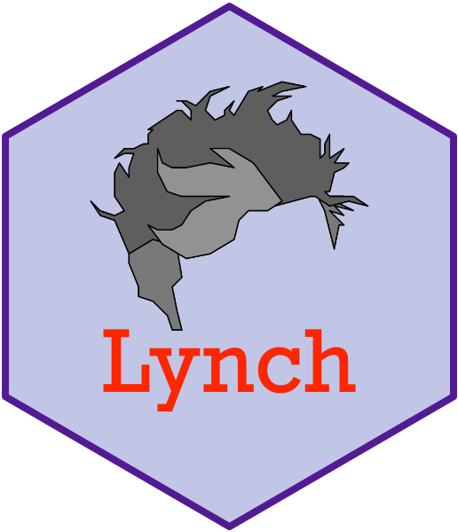

# A David Lynch palette generator

 Color palettes from David Lynch
films.

## Usage

``` r
lynch_palette(name, n, type = c("discrete", "sequential", "diverging"))
```

## Arguments

- name:

  Name of the palette, such as `"twin_peaks"` or `"blue_velvet_safe"`.
  See `names(lynch_palettes)`, `names(lynch_sequential)` and
  `names(lynch_diverging)`.

- n:

  Number of colours. If omitted, uses all colours. Discrete palettes
  offer at most their own colours; sequential and diverging ramps are
  interpolated to any `n`. Most discrete colour schemes are derived from
  [this Pin on
  Pinterest](https://www.pinterest.se/pin/151152131226891232/).

- type:

  `"discrete"` for categories, `"sequential"` for ordered values,
  `"diverging"` for values either side of a midpoint.

## Value

A character vector of hex colours with class `palette`. Printing it
draws the colours as swatches; use
[`unclass()`](https://rdrr.io/r/base/class.html) for a plain vector.

## See also

[`scale_colour_lynch_d()`](https://gkaramanis.github.io/Lynch/reference/scale_colour_lynch_d.md)
and
[`scale_colour_lynch_c()`](https://gkaramanis.github.io/Lynch/reference/scale_colour_lynch_d.md)
for ggplot2.

## Examples

``` r
lynch_palette("twin_peaks")

lynch_palette("blue_velvet", 3)

lynch_palette("blue_velvet_safe")

lynch_palette("dune", 12, type = "sequential")

lynch_palette("mulholland_drive", type = "diverging")


# Plain colours for base graphics
cols <- unclass(lynch_palette("lost_highway"))
pie(rep(1, 5), col = cols)
```
